<p align="center">
  
</p>

<p align="center">
  <a href="https://ptravesso-dba.github.io"></a>
  &nbsp;
  <a href="https://www.linkedin.com/in/pablo-travesso-141082232/"></a>
</p>

<p align="center">
  
</p>

```sql
SQL> SELECT relic, purpose FROM pablo.repositories WHERE visibility = 'PUBLIC';
```

<!--RELICS:START-->
<p align="center">
  <a href="https://github.com/ptravesso-dba/install-automation19"></a>
  <a href="https://github.com/ptravesso-dba/oratop-monitor"></a>
  <a href="https://github.com/ptravesso-dba/preventiva"></a>
</p>
<!--RELICS:END-->

<p align="center">
   exit. Disconnected from Oracle AI Database 26ai. The bonfire stays lit.">
</p>

<p align="center"><sub>Not into games? The look of this profile, and of the whole ecosystem around it, is inspired by the Souls-like series, Dark Souls in particular: bonfires, rings, relics, a status sheet. A deliberate visual identity, not a joke.</sub></p>

<!-- Generated: edit build/build.pl and run `perl build.pl` (see build/COMO-ATUALIZAR.md). The RELICS block below the SQL line is rewritten by the build. -->
