<p align="center">
  
</p>

<p align="center">
  <a href="https://ptravesso-dba.github.io"></a>
  &nbsp;
  <a href="https://www.linkedin.com/in/pablo-travesso-141082232/"></a>
</p>

<p align="center">
  
</p>

```sql
SQL> SELECT relic, purpose FROM pablo.repositories WHERE visibility = 'PUBLIC';
```

<p align="center">
  <a href="https://github.com/ptravesso-dba/install-automation19"></a>
  <a href="https://github.com/ptravesso-dba/oratop-monitor"></a>
  <a href="https://github.com/ptravesso-dba/preventiva"></a>
</p>

<p align="center">
   exit. Disconnected from Oracle Database 19c. The bonfire stays lit.">
</p>

<!-- Source of the images: build/ (perl build/build.pl regenerates assets/). -->
